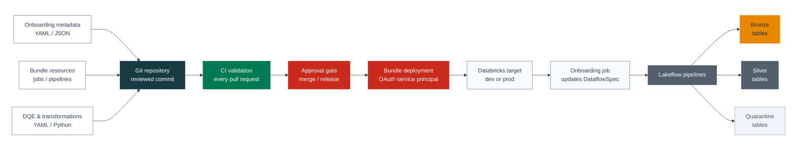

# CI/CD Automation

Use the SDP-META Declarative Automation Bundle (DAB) as the deployment
contract between Git and Databricks. Keep bundle resources, onboarding
metadata, data-quality rules, and Silver transformations in source control;
then let CI validate and deploy the same reviewed files to each environment.

This guide assumes that the bundle was created with
`databricks labs sdp-meta bundle-init`.

## Recommended GitOps flow

A deployment pipeline normally performs these steps:

<div className="ci-cd-flow-diagram">



</div>

For example, a developer adding a source table typically changes:

- `conf/onboarding.yml` (or `onboarding.json`) to define the flow;
- `conf/dqe/<table>/bronze_expectations.yml` for data-quality rules;
- `conf/silver_transformations.yml` for Silver projections.

The pull request validates the bundle without changing the workspace. After
merge, deployment uploads the reviewed configuration, onboarding updates the
DataflowSpec tables, and the pipeline run processes the new flow.

A topology change follows the same path. For example, changing
`resources/sdp_meta_pipelines.yml` to add a pipeline or dependency is validated
in the pull request, deployed after merge, and then verified by running the
affected onboarding and pipeline jobs. Production promotes the same Git commit
with a separate target, service principal, and approval gate.

```bash
databricks bundle validate --target dev
databricks bundle deploy --target dev
databricks bundle run onboarding --target dev
databricks bundle run pipelines --target dev
```

The commands have different responsibilities:

1. `bundle validate` checks the Databricks bundle syntax and resolves the
   selected target.
2. `bundle deploy` creates or updates the declared jobs and Lakeflow Spark
   Declarative Pipelines.
3. `bundle run onboarding` converts the committed onboarding metadata into
   Bronze and Silver DataflowSpec tables.
4. `bundle run pipelines` starts the deployed pipeline topology.

Run validation for every pull request. Run deployment and onboarding after a
merge to the environment branch. Whether CI should immediately run the
pipelines depends on the operating model: scheduled pipelines may only need
deployment, while release pipelines often run them as a post-deployment
verification step.

:::warning Current `bundle-validate` limitation
`databricks labs sdp-meta bundle-validate` currently prompts for the bundle
directory and target. It is not suitable for an unattended runner yet.

Use `databricks bundle validate --target <target>` in CI. This performs the
standard Databricks bundle validation, but it does not run the additional
SDP-META checks for flow groups, pipeline ownership, dependency wiring, or
placeholder values.

Non-interactive `--bundle-dir` and `--target` support for the SDP-META command
is tracked separately. Continue to run `databricks labs sdp-meta
bundle-validate` locally before merging changes that alter SDP-META topology.
:::

## Authenticate without a local profile

Databricks CLI profiles are convenient for developer workstations. CI runners
should use Databricks unified authentication with a service principal.

Configure these secret environment variables:

```bash
DATABRICKS_HOST=https://<workspace-host>
DATABRICKS_CLIENT_ID=<service-principal-application-id>
DATABRICKS_CLIENT_SECRET=<service-principal-oauth-secret>
```

No `--profile` argument is required when these variables are set. Use a
different service principal and secret set for each environment.

Before deploying, a pipeline can verify its identity without printing a
secret:

```bash
databricks auth describe
databricks current-user me
```

For older environments, `DATABRICKS_HOST` plus `DATABRICKS_TOKEN` is also
supported. OAuth machine-to-machine authentication is preferred because its
credentials are scoped to a service principal and can be rotated without
depending on a user account.

## GitHub Actions example

Store development credentials as repository or organization secrets so the
pull-request validation job can access them. Store production credentials as
secrets in a protected GitHub `production` environment so deployment requires
the configured reviewers.

GitHub does not expose repository or environment secrets to workflows from
forks or Dependabot pull requests. The example skips authenticated validation
for those pull requests; review the contribution before a maintainer runs
validation from a trusted branch.

```yaml title=".github/workflows/deploy-sdp-meta.yml"
name: Deploy SDP-META

on:
  pull_request:
    paths:
      - "bundle/**"
      - ".github/workflows/deploy-sdp-meta.yml"
  push:
    branches: [main]
    paths:
      - "bundle/**"
      - ".github/workflows/deploy-sdp-meta.yml"
  workflow_dispatch:

permissions:
  contents: read

jobs:
  validate:
    if: >-
      github.event_name != 'pull_request' ||
      (
        github.actor != 'dependabot[bot]' &&
        github.event.pull_request.head.repo.full_name == github.repository
      )
    runs-on: ubuntu-latest
    defaults:
      run:
        working-directory: bundle
    env:
      DATABRICKS_HOST: ${{ secrets.DATABRICKS_HOST }}
      DATABRICKS_CLIENT_ID: ${{ secrets.DATABRICKS_CLIENT_ID }}
      DATABRICKS_CLIENT_SECRET: ${{ secrets.DATABRICKS_CLIENT_SECRET }}
    steps:
      - uses: actions/checkout@v4
      - uses: databricks/setup-cli@v1.16.1
      - run: databricks bundle validate --target dev

  deploy-dev:
    if: github.event_name == 'push'
    needs: validate
    runs-on: ubuntu-latest
    environment: development
    concurrency: sdp-meta-development
    defaults:
      run:
        working-directory: bundle
    env:
      DATABRICKS_HOST: ${{ secrets.DATABRICKS_HOST }}
      DATABRICKS_CLIENT_ID: ${{ secrets.DATABRICKS_CLIENT_ID }}
      DATABRICKS_CLIENT_SECRET: ${{ secrets.DATABRICKS_CLIENT_SECRET }}
    steps:
      - uses: actions/checkout@v4
      - uses: databricks/setup-cli@v1.16.1
      - run: databricks bundle deploy --target dev
      - run: databricks bundle run onboarding --target dev
      - run: databricks bundle run pipelines --target dev
```

Pin third-party actions to an approved release or immutable commit SHA
according to the organization's supply-chain policy.

For production, use a separate job with `environment: production`, production
secrets, `--target prod`, and required environment reviewers. Do not reuse
development credentials for production.

## Azure DevOps example

Create a variable group named `sdp-meta-development` containing
`DATABRICKS_HOST`, `DATABRICKS_CLIENT_ID`, and `DATABRICKS_CLIENT_SECRET`.
Back it with Azure Key Vault when available, and mark credential values as
secret.

```yaml title="azure-pipelines.yml"
trigger:
  branches:
    include:
      - main
  paths:
    include:
      - bundle/*

pr:
  paths:
    include:
      - bundle/*

variables:
  - group: sdp-meta-development

stages:
  - stage: Validate
    jobs:
      - job: ValidateBundle
        pool:
          vmImage: ubuntu-latest
        steps:
          - checkout: self
          - bash: |
              curl -fsSL https://raw.githubusercontent.com/databricks/setup-cli/main/install.sh | sh
              databricks bundle validate --target dev
            workingDirectory: $(Build.SourcesDirectory)/bundle
            env:
              DATABRICKS_HOST: $(DATABRICKS_HOST)
              DATABRICKS_CLIENT_ID: $(DATABRICKS_CLIENT_ID)
              DATABRICKS_CLIENT_SECRET: $(DATABRICKS_CLIENT_SECRET)

  - stage: DeployDevelopment
    dependsOn: Validate
    condition: |
      and(
        succeeded(),
        eq(variables['Build.SourceBranch'], 'refs/heads/main')
      )
    jobs:
      - deployment: DeployBundle
        environment: sdp-meta-development
        pool:
          vmImage: ubuntu-latest
        strategy:
          runOnce:
            deploy:
              steps:
                - checkout: self
                - bash: |
                    curl -fsSL https://raw.githubusercontent.com/databricks/setup-cli/main/install.sh | sh
                    databricks bundle deploy --target dev
                    databricks bundle run onboarding --target dev
                    databricks bundle run pipelines --target dev
                  workingDirectory: $(Build.SourcesDirectory)/bundle
                  env:
                    DATABRICKS_HOST: $(DATABRICKS_HOST)
                    DATABRICKS_CLIENT_ID: $(DATABRICKS_CLIENT_ID)
                    DATABRICKS_CLIENT_SECRET: $(DATABRICKS_CLIENT_SECRET)
```

Use an Azure DevOps environment with approvals and checks for production.
Pin or internally mirror the Databricks CLI installer when required by the
organization's software-supply policy.

## Secrets and least privilege

Store OAuth secrets in the CI/CD platform's secret manager or an integrated
key-management service. Never place credentials in:

- repository files or bundle variables;
- command-line arguments that may appear in logs;
- build artifacts;
- onboarding YAML or JSON.

Grant the deployment service principal only the permissions required by the
selected bundle. The exact set depends on whether the bundle creates schemas
and Volumes or uses pre-provisioned resources. Common requirements include:

- workspace access and permission to create or manage the bundle's jobs and
  pipelines;
- permission to run as the configured production service principal, if
  `run_as` is used;
- `USE CATALOG` on the configured catalog;
- `USE SCHEMA` and `CREATE TABLE` on the DataflowSpec and target schemas;
- `CREATE SCHEMA` only when automation is expected to create missing schemas;
- `READ VOLUME` and `WRITE VOLUME` on the configuration or wheel Volumes;
- `CREATE VOLUME` only when the bundle is expected to create a missing Volume;
- access to source tables, external locations, secrets, or message systems
  referenced by onboarding metadata.

Prefer grants on the specific catalog, schemas, and Volumes used by the
bundle. Avoid workspace-admin or metastore-admin credentials in CI.

## Environment targets and approvals

Keep non-secret environment differences in bundle targets:

```yaml title="databricks.yml"
variables:
  prod_service_principal:
    description: Application ID of the production deployment service principal

targets:
  dev:
    mode: development
    default: true
    variables:
      development_enabled: true

  prod:
    mode: production
    variables:
      development_enabled: false
    run_as:
      service_principal_name: ${var.prod_service_principal}
```

Use bundle variables for catalog names, schema names, and other deploy-time
settings. CI can override a declared variable through a `BUNDLE_VAR_` variable:

```bash
export BUNDLE_VAR_uc_catalog_name=my_environment_catalog
export BUNDLE_VAR_prod_service_principal=<production-service-principal-application-id>
databricks bundle validate --target prod
```

Recommended controls:

- validate pull requests against the development target;
- require review for changes under `resources/`, `conf/`, and `databricks.yml`;
- protect the production environment with manual approvals;
- serialize deployments to the same target;
- use separate service principals and secret scopes for development and
  production;
- deploy immutable commits, not an uncommitted working tree.

## Choose a wheel strategy

### PyPI coordinate

Use a pinned package coordinate when the pipeline environment can reach the
configured package index:

```yaml title="resources/variables.yml"
wheel_source:
  default: pypi
sdp_meta_dependency:
  default: databricks-labs-sdp-meta==0.2.0
```

This is the simplest strategy for public releases. Always pin a version; do
not use an unbounded dependency in production.

### Unity Catalog Volume

Use a Volume-hosted wheel when clusters cannot access PyPI, when releases are
promoted through an internal artifact process, or when testing an unreleased
build:

```yaml title="resources/variables.yml"
wheel_source:
  default: volume_path
sdp_meta_dependency:
  default: /Volumes/<catalog>/<schema>/<volume>/databricks_labs_sdp_meta-0.2.0-py3-none-any.whl
```

For a released version, download and upload the pinned wheel in a separate
artifact stage:

```bash
python -m pip download \
  --only-binary=:all: \
  --no-deps \
  --dest dist \
  databricks-labs-sdp-meta==0.2.0
databricks fs cp \
  dist/databricks_labs_sdp_meta-0.2.0-py3-none-any.whl \
  dbfs:/Volumes/<catalog>/<schema>/<volume>/databricks_labs_sdp_meta-0.2.0-py3-none-any.whl \
  --overwrite
```

Promote the same wheel artifact between environments rather than rebuilding
it for production. To test an unreleased version, first check out the SDP-META
source and run `python -m pip wheel --no-deps --wheel-dir dist .` from the
repository root. `databricks labs sdp-meta bundle-prepare-wheel` is useful for
interactive local workflows; an explicit download-or-build and upload stage is
easier to audit and reproduce in CI.

## Reliability, retries, and rollback

### Idempotency

`databricks bundle deploy` is declarative and may be run repeatedly for the
same target. The onboarding and pipeline runs are workload operations:

- onboarding behavior depends on `overwrite_dataflowspecs` and the metadata
  keys being imported;
- pipeline rerun behavior depends on source checkpoints, full-refresh
  settings, and the declared flow semantics.

Treat deployment as idempotent, but evaluate workload reruns for each source
before adding automatic retries.

### Failure handling

Stop the release when validation, deployment, onboarding, or pipeline
execution returns a non-zero status. Capture the command output as a CI
artifact, but redact logs if they may contain source configuration or secret
references.

Retry transient platform failures with a bounded retry policy. Do not blindly
retry validation failures, permission failures, or invalid metadata.

### Rollback

Bundle deployment does not provide an application-style automatic rollback.
To restore bundle configuration:

1. revert to the last known-good Git commit;
2. validate that commit against the target;
3. redeploy it;
4. rerun onboarding if its committed metadata changed;
5. run the pipelines only after reviewing the data-processing impact.

Redeploying configuration does not undo data already written by a pipeline.
Use Delta table history, backups, or a workload-specific recovery procedure
for data rollback.

### Cleanup

For ephemeral development environments, remove bundle-managed resources with:

```bash
databricks bundle destroy --target dev --auto-approve
```

Do not run automated destroy commands against production. Separately govern
data tables, schemas, Volumes, checkpoints, and external cloud resources that
are not owned by the bundle.

## Operational checklist

Before enabling automated deployment:

- pin the Databricks CLI and SDP-META versions;
- verify service-principal identity and least-privilege grants;
- validate both development and production targets;
- confirm the onboarding mode and pipeline rerun behavior;
- configure deployment concurrency;
- protect production with an approval gate;
- retain command logs and deployment metadata;
- document data rollback separately from bundle rollback;
- test cleanup only in an isolated development target.

For common deployment errors, see [Troubleshooting](./troubleshooting).
